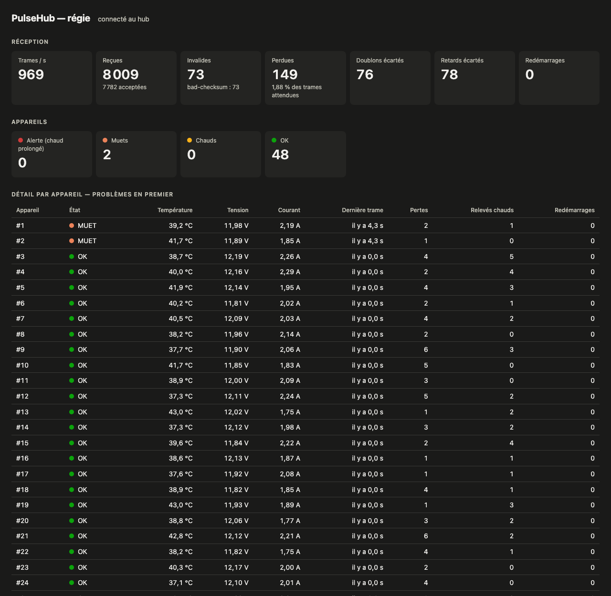
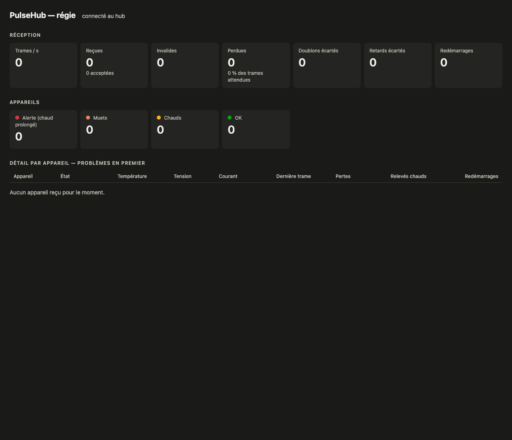
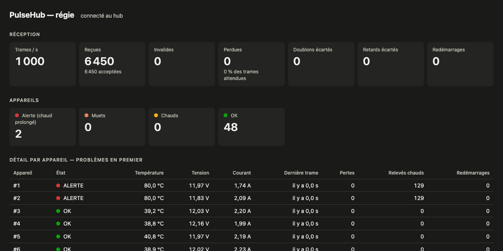

# PulseHub

Hub central de télémétrie UDP temps réel (protocole PulseHub v1) et simulateur d'équipements d'événementiel, en TypeScript / Node.js, **sans aucune dépendance d'exécution**.

La régie voit en direct **si la réception est saine, quel équipement chauffe et lequel ne répond plus**.



---

## 1. Démarrage local

**Prérequis** : Node.js **≥ 22.18** (exécution native du TypeScript) et npm. Développé et testé avec **Node 26.7 / npm 11.19** sur macOS ; la CI tourne sous Linux avec Node 26.

```bash
git clone https://github.com/Samy951/pulsehub.git
cd pulsehub
npm ci
```

| Je veux…                                                         | Commande                                                                                                                  |
| ---------------------------------------------------------------- | ------------------------------------------------------------------------------------------------------------------------- |
| Lancer le **hub** (UDP 9000) **et la visualisation**             | `npm run hub` puis ouvrir **<http://localhost:8080>**                                                                       |
| Lancer le **simulateur** (50 appareils × 20 Hz = 1 000 trames/s) | `npm run sim` (dans un 2ᵉ terminal)                                                                                       |
| Simulateur **avec tous les défauts**                             | `npm run sim -- --bad-checksum 0.01 --duplicate 0.01 --reorder 0.01 --anomaly 0.01 --stop 2 --stop-after 10 --overheat 2` |
| Lancer les **tests**                                             | `npm test`                                                                                                                |
| Lint / vérification des types                                    | `npm run lint` / `npm run typecheck`                                                                                      |
| Mesurer le **débit maximal** du hub                              | `npm run bench` (≈ 1 min)                                                                                                 |

**Test d'acceptation** : au démarrage du hub, la page affiche des zéros partout ; dès que le simulateur démarre, les valeurs évoluent et chaque défaut injecté est visible (voir [section 3](#3-synthèse-et-visualisation)).

### Options du simulateur

| Option                        | Défaut           | Effet                                                         |
| ----------------------------- | ---------------- | ------------------------------------------------------------- |
| `--devices N`                 | 50               | nombre d'appareils                                            |
| `--rate F`                    | 20               | trames par seconde et par appareil                            |
| `--host` / `--port`           | 127.0.0.1 / 9000 | adresse du hub                                                |
| `--first-id`                  | 1                | premier numéro d'appareil (plusieurs simulateurs côte à côte) |
| `--bad-checksum p`            | 0                | probabilité (0 à 1) d'un checksum faux                        |
| `--duplicate p`               | 0                | probabilité d'envoyer une trame en double                     |
| `--reorder p`                 | 0                | probabilité de livrer une trame après la suivante             |
| `--anomaly p`                 | 0                | probabilité d'un pic à 95 °C                                  |
| `--stop N` / `--stop-after s` | 0 / 10           | les appareils 1..N se taisent après s secondes                |
| `--overheat N`                | 0                | les appareils 1..N restent à 80 °C (déclenche l'alerte)       |

Une option inconnue ou hors bornes est refusée avec un message clair.

### Réglages du hub

Aucun paramètre n'est écrit en dur : chacun a une valeur par défaut et se règle par variable d'environnement, ou dans un fichier `.env` (`cp .env.example .env`, le vrai `.env` est ignoré par git).

| Variable                   | Défaut | Rôle                                                      |
| -------------------------- | ------ | --------------------------------------------------------- |
| `PULSEHUB_UDP_PORT`        | 9000   | port UDP d'écoute des trames                              |
| `PULSEHUB_HTTP_PORT`       | 8080   | port de la page de la régie                               |
| `PULSEHUB_REFRESH_MS`      | 500    | fréquence d'envoi de la synthèse à la page                |
| `PULSEHUB_SILENT_AFTER_MS` | 2000   | sans trame depuis ce délai → appareil **MUET**            |
| `PULSEHUB_HOT_CELSIUS`     | 70     | au-dessus → appareil **CHAUD**                            |
| `PULSEHUB_ALERT_AFTER_MS`  | 3000   | chaud sans interruption pendant ce délai → **ALERTE**     |
| `PULSEHUB_REBOOT_GAP_MS`   | 3000   | recul d'`uptimeMs` au-delà duquel un appareil a redémarré |

---

## 2. Vue d'ensemble de l'architecture

```mermaid
flowchart LR
  subgraph SIM["Simulateur — npm run sim"]
    DEV["VirtualDevice ×N<br/>simulator/device.ts"] --> FAULT["FaultInjector<br/>simulator/faults.ts"]
    FAULT --> ENC["encode()<br/>protocol/encode.ts"]
  end

  ENC -- "UDP :9000 — 1 trame par datagramme" --> REC

  subgraph HUB["Hub — npm run hub (composé dans hub/main.ts)"]
    REC["startReceiver<br/>hub/receiver.ts"] --> PIPE["Pipeline.handle<br/>hub/pipeline.ts"]
    PIPE --> DEC["decode()<br/>protocol/decode.ts"]
    DEC -- "trame valide" --> SEQ["Sequencer<br/>hub/sequencer.ts"]
    DEC -- "invalide + raison" --> SUM
    SEQ -- "acceptée · doublon · retard · redémarrage" --> SUM["FleetSummary<br/>hub/summary.ts"]
    SUM -- "snapshot() toutes les 500 ms" --> DASH["startDashboard<br/>hub/dashboard.ts"]
  end

  DASH -- "HTTP :8080 — SSE /events" --> UI["Navigateur<br/>public/index.html"]
```



**Parcours d'une trame** :

1. Un `VirtualDevice` produit sa trame suivante (seq + 1, uptime, température / tension / courant).
2. Le `FaultInjector` applique éventuellement un défaut, puis `encode()` produit les octets (big-endian, checksum XOR).
3. Le datagramme part en UDP vers le hub ; `startReceiver` le passe à `Pipeline.handle`, sans jamais laisser une erreur arrêter le hub.
4. `decode()` valide la trame (taille, magic, version, type, longueur, checksum, deviceId, métriques) ; une trame invalide est **comptée avec sa raison**.
5. Le `Sequencer` juge la trame par rapport à la dernière acceptée de cet appareil : acceptée (avec les pertes éventuelles), doublon, retard ou redémarrage.
6. La `FleetSummary` met à jour les compteurs et l'état de l'appareil.
7. Toutes les 500 ms, `startDashboard` envoie la synthèse à chaque page ouverte en **Server-Sent Events** ; la page redessine les tuiles et le tableau.

```
src/
  protocol/   frame.ts (format v1), encode.ts, decode.ts      — partagé par le simulateur et le hub
  simulator/  device.ts, faults.ts, config.ts, main.ts
  hub/        receiver.ts, pipeline.ts, sequencer.ts, summary.ts, rate-counter.ts,
              dashboard.ts, config.ts, main.ts
  shared/     parse-number.ts                                 — validation des réglages
public/index.html                                             — page de la régie
scripts/benchmark.ts                                          — mesure du débit
test/                                                         — miroir de src/ (node:test)
```

---

## 3. Synthèse et visualisation

### Ce que calcule la synthèse, et pourquoi

Elle répond aux trois questions de la régie posées par le sujet :

| Question                          | Ce qui est affiché                                                                                                            | Pourquoi c'est utile                                                                                                            |
| --------------------------------- | ----------------------------------------------------------------------------------------------------------------------------- | ------------------------------------------------------------------------------------------------------------------------------- |
| **La réception est-elle saine ?** | trames/s, reçues, acceptées, **invalides par raison**, doublons et retards écartés, **pertes et taux de perte**, redémarrages | distinguer un problème réseau (pertes, désordre) d'un équipement défaillant (checksums faux)                                    |
| **Quel équipement chauffe ?**     | état **CHAUD** (> 70 °C) puis **ALERTE** (chaud depuis 3 s), colonne « relevés chauds »                                       | un pic isolé n'est pas une panne ; une chaleur qui dure en est une. Le compteur garde la trace des pics brefs, invisibles sinon |
| **Lequel ne répond plus ?**       | état **MUET** (aucune trame depuis 2 s), « dernière trame il y a X s »                                                        | repérer immédiatement un équipement débranché ou planté                                                                         |

Par appareil : état, température (°C), tension (V), courant (A), dernière trame, pertes, relevés chauds, redémarrages. Les valeurs sont converties en unités lisibles (°C, V, A) **dans la synthèse**, pas dans la page. Le tableau affiche **les problèmes en premier** (ALERTE, MUET, CHAUD, puis OK).

### Pourquoi une page web + SSE

- Le flux va **dans un seul sens**, du hub vers la régie : les Server-Sent Events suffisent (HTTP standard, reconnexion automatique du navigateur, **aucune dépendance** côté serveur avec `node:http`). WebSocket ne se justifierait que si la régie envoyait des commandes.
- Une page web affiche 50 appareils en couleurs, se montre facilement en soutenance et s'ouvre depuis n'importe quel poste de la régie.
- Écrite en une journée : un fichier HTML, du JavaScript sans framework, construit avec `textContent` (aucune injection HTML possible).
- Thème sombre (régie de spectacle) ; les couleurs d'état sont réservées aux états et **toujours accompagnées d'un libellé**.

| Au démarrage du hub : zéros partout               | Défaut `--overheat 2` : alerte après 3 s              |
| ------------------------------------------------- | ----------------------------------------------------- |
|  |  |

Défauts injectés (1 % chacun) et ce qu'on voit (capture en tête de ce README) : checksum faux → **Invalides** (`bad-checksum`) ; doublons → **Doublons écartés** ; désordre → **Retards écartés** + pertes ; valeur anormale → **Relevés chauds** ; arrêt → appareils **MUETS** en haut du tableau.

---

## 4. Principes de conception

Liens vers le commit [`1369995`](https://github.com/Samy951/pulsehub/tree/13699955a27fd3b738642c5a87c4b51b133ffccd).

| Principe                                            | Explication                                                                                                                                                                                                                                              | Code                                                                                                                                                                                                                                                                                                                                                                                                                         |
| --------------------------------------------------- | -------------------------------------------------------------------------------------------------------------------------------------------------------------------------------------------------------------------------------------------------------- | ---------------------------------------------------------------------------------------------------------------------------------------------------------------------------------------------------------------------------------------------------------------------------------------------------------------------------------------------------------------------------------------------------------------------------- |
| **Séparation des responsabilités (S de SOLID)**     | Chaque module a une seule raison de changer : le récepteur ne fait que de l'UDP, le décodeur que du binaire, le séquenceur que l'ordre, la synthèse que l'état, le serveur que l'affichage. `Pipeline` ne fait que les enchaîner.                        | [pipeline.ts#L15-L23](https://github.com/Samy951/pulsehub/blob/13699955a27fd3b738642c5a87c4b51b133ffccd/src/hub/pipeline.ts#L15-L23) · [receiver.ts#L5-L24](https://github.com/Samy951/pulsehub/blob/13699955a27fd3b738642c5a87c4b51b133ffccd/src/hub/receiver.ts#L5-L24)                                                                                                                                                    |
| **Injection de dépendances, racine de composition** | Aucun module ne fabrique ses dépendances : `main.ts` est le seul endroit qui construit les pièces et les passe aux constructeurs. Sans framework.                                                                                                        | [hub/main.ts#L9-L22](https://github.com/Samy951/pulsehub/blob/13699955a27fd3b738642c5a87c4b51b133ffccd/src/hub/main.ts#L9-L22)                                                                                                                                                                                                                                                                                               |
| **Inversion de dépendance (D de SOLID)**            | Le serveur de la page dépend d'une simple fonction `snapshot: () => unknown`, pas de la classe `FleetSummary` : on le teste avec un faux objet, et la synthèse peut changer sans le toucher.                                                             | [dashboard.ts#L10](https://github.com/Samy951/pulsehub/blob/13699955a27fd3b738642c5a87c4b51b133ffccd/src/hub/dashboard.ts#L10)                                                                                                                                                                                                                                                                                               |
| **Testabilité par injection**                       | Le temps (`now`) et l'aléatoire (`random`) sont passés en paramètre : les tests fixent l'heure et le hasard et connaissent le résultat exact.                                                                                                            | [device.ts#L16-L22](https://github.com/Samy951/pulsehub/blob/13699955a27fd3b738642c5a87c4b51b133ffccd/src/simulator/device.ts#L16-L22) · [faults.ts#L73-L75](https://github.com/Samy951/pulsehub/blob/13699955a27fd3b738642c5a87c4b51b133ffccd/src/simulator/faults.ts#L73-L75)                                                                                                                                              |
| **DRY**                                             | Le format du protocole n'existe qu'une fois (positions, tailles, checksum), partagé par l'encodeur du simulateur et le décodeur du hub ; la validation des réglages est commune aux deux configurations ; pic et surchauffe partagent `withTemperature`. | [frame.ts#L10-L55](https://github.com/Samy951/pulsehub/blob/13699955a27fd3b738642c5a87c4b51b133ffccd/src/protocol/frame.ts#L10-L55) · [parse-number.ts#L2-L14](https://github.com/Samy951/pulsehub/blob/13699955a27fd3b738642c5a87c4b51b133ffccd/src/shared/parse-number.ts#L2-L14) · [faults.ts#L29-L34](https://github.com/Samy951/pulsehub/blob/13699955a27fd3b738642c5a87c4b51b133ffccd/src/simulator/faults.ts#L29-L34) |
| **KISS**                                            | Zéro dépendance d'exécution, modules intégrés à Node (`dgram`, `http`, `test`, `util.parseArgs`) ; décodeur en une suite de contrôles lisibles de haut en bas ; SSE plutôt que WebSocket.                                                                | [decode.ts#L33-L63](https://github.com/Samy951/pulsehub/blob/13699955a27fd3b738642c5a87c4b51b133ffccd/src/protocol/decode.ts#L33-L63)                                                                                                                                                                                                                                                                                        |
| **Gestion des erreurs**                             | Une trame invalide est un cas normal en UDP : `decode` renvoie un résultat typé (`ok` / `error`) au lieu de lever une exception ; le récepteur isole chaque datagramme ; un réglage invalide arrête le démarrage avec un message qui nomme le réglage.   | [decode.ts#L28-L30](https://github.com/Samy951/pulsehub/blob/13699955a27fd3b738642c5a87c4b51b133ffccd/src/protocol/decode.ts#L28-L30) · [receiver.ts#L8-L14](https://github.com/Samy951/pulsehub/blob/13699955a27fd3b738642c5a87c4b51b133ffccd/src/hub/receiver.ts#L8-L14) · [parse-number.ts#L2-L8](https://github.com/Samy951/pulsehub/blob/13699955a27fd3b738642c5a87c4b51b133ffccd/src/shared/parse-number.ts#L2-L8)     |
| **Configuration externalisée**                      | Ports, délais et seuils en un seul endroit, avec défauts, surchargés par l'environnement ou `.env`.                                                                                                                                                      | [hub/config.ts#L14-L38](https://github.com/Samy951/pulsehub/blob/13699955a27fd3b738642c5a87c4b51b133ffccd/src/hub/config.ts#L14-L38)                                                                                                                                                                                                                                                                                         |
| **Typage strict**                                   | TypeScript `strict` + `noUncheckedIndexedAccess`, aucun `any` (explicite ou implicite, vérifié par le lint), fonctions de 50 lignes maximum, unions discriminées pour les verdicts du séquenceur.                                                        | [sequencer.ts#L24-L44](https://github.com/Samy951/pulsehub/blob/13699955a27fd3b738642c5a87c4b51b133ffccd/src/hub/sequencer.ts#L24-L44)                                                                                                                                                                                                                                                                                       |

---

## 5. Choix et compromis

### Outils retenus et écartés

| Besoin                 | Retenu                                                                         | Écarté, et pourquoi                                                                                                                                                                                                                      |
| ---------------------- | ------------------------------------------------------------------------------ | ---------------------------------------------------------------------------------------------------------------------------------------------------------------------------------------------------------------------------------------- |
| Exécution TypeScript   | **Node 26, exécution native** (suppression des types)                          | `tsc` → `dist/`, `tsx` : une étape de build inutile. Contrepartie : pas d'`enum` ni de `constructor(private x)` (objets `as const` à la place)                                                                                           |
| Vérification des types | **TypeScript 7** (`tsc --noEmit`)                                              | —                                                                                                                                                                                                                                        |
| Visualisation          | **`node:http` + SSE + page HTML**                                              | **NestJS** + WebSocket : au moins 6 dépendances, une étape de compilation (décorateurs), beaucoup de code à justifier pour 2 routes ; WebSocket inutile pour un flux à sens unique. Interface terminal : moins lisible pour 50 appareils |
| Tests                  | **`node:test`** (intégré : mocks, faux temps)                                  | **Jest** : `ts-jest` exige TypeScript < 7 et l'ESM y reste expérimental. **Supertest** : sert à tester des API, pas un flux SSE. **Vitest** : seulement la syntaxe en plus, 2 dépendances                                                |
| Lint                   | **Oxlint + oxlint-tsgolint** (règles ESLint, analyse de types de TypeScript 7) | **ESLint** : `typescript-eslint` exige TypeScript < 6.1 ; rétrograder TypeScript a été refusé                                                                                                                                            |
| Erreurs typées, flux   | type union + événements `dgram`                                                | **Effect** : puissant mais long à maîtriser et à expliquer en une journée, et zone grise vis-à-vis de l'interdiction des bibliothèques qui calculent à notre place                                                                       |
| Options du simulateur  | `node:util` `parseArgs`                                                        | `commander`, `yargs` : une dépendance pour quelques lignes                                                                                                                                                                               |

### Gestion des pertes et du séquencement

- Le séquenceur garde, par appareil, la **dernière trame acceptée** (seq et uptime).
- `seq` égal → **doublon**, écarté. `seq` déjà dépassé → **retard**, écarté (consigne du sujet).
- `seq` plus grand → acceptée ; les numéros sautés sont comptés comme **pertes**.
- La comparaison se fait **modulo 2³²** : `0` vient juste après `4 294 967 295` (bonus retour à zéro).
- **Redémarrage** (bonus) : si `uptimeMs` recule de plus de `PULSEHUB_REBOOT_GAP_MS` alors que `seq` n'avance pas, l'appareil a redémarré : on repart de zéro pour lui. La condition sur `seq` évite de confondre avec le retour à zéro d'`uptimeMs` (au bout de 49 jours).
- **Choix assumés** : une trame qui arrive en retard après avoir été comptée perdue **reste comptée perdue** (le sujet demande de l'écarter) ; une trame corrompue est comptée **invalide et perdue** (son numéro manque). Le taux de perte = perdues / (acceptées + perdues).

### Mesure du débit maximal (bonus)

**Méthode** (`npm run bench`) : le script fait tourner **la même chaîne que le hub** (récepteur → décodage → séquenceur → synthèse) sur un port dédié et lance 1 à 4 **vrais simulateurs** en parallèle, chacun sur sa plage d'appareils (`--first-id`), 10 s par palier. Il compare ce que les simulateurs ont **réellement envoyé** (leur propre compteur) avec ce que la synthèse a **accepté** et **perdu**. Le débit maximal soutenu est le plus haut palier **sans perte**.

Résultats sur un Apple M1 Pro (8 cœurs), en local :

| Simulateurs | Demandé (trames/s) | Envoyé  | Accepté | Pertes  |
| ----------- | ------------------ | ------- | ------- | ------- |
| 1           | 1 000              | 981     | 970     | 0 %     |
| 1           | 100 000            | 96 250  | 94 960  | 0 %     |
| 2           | 200 000            | 174 125 | 170 268 | **0 %** |
| 3           | 300 000            | 196 250 | 182 683 | 4,63 %  |
| 4           | 400 000            | 227 750 | 169 085 | 23,24 % |

→ **≈ 170 000 trames/s sans perte**, soit 170 fois la charge nominale. Au-delà, le tampon UDP du système déborde et le hub perd des trames. Un seul simulateur plafonne vers 130 000 trames/s, d'où l'exécution en parallèle. L'écart « envoyé / accepté » à 0 % de perte vient du démarrage des simulateurs pendant la fenêtre de 10 s.

### Simplifié faute de temps

- Pas d'historique persistant ni de chaîne de traitement déclarée en JSON/YAML (bonus non traités).
- Le simulateur n'envoie que des trames TELEMETRY ; le hub accepte aussi les HEARTBEAT.
- La synthèse est en mémoire : redémarrer le hub remet les compteurs à zéro.

---

## 6. Limites connues

- **Mesure de débit** : simulateurs et hub partagent la même machine ; le chiffre est un minimum, dépendant du matériel. Le serveur de la page n'est pas inclus dans la mesure (une synthèse toutes les 500 ms, négligeable).
- **Redémarrage très rapide** : un appareil qui redémarre avant d'avoir tourné `PULSEHUB_REBOOT_GAP_MS` n'est pas détecté ; ses trames sont vues « en retard » jusqu'à ce que son `seq` dépasse l'ancien (au plus quelques secondes).
- **Pertes en fin de flux** : les trames perdues juste avant qu'un appareil se taise ne sont pas comptées (aucune trame suivante ne révèle le trou) ; l'appareil apparaît MUET.
- **Sécurité** : la page et le port UDP n'ont ni authentification ni chiffrement (réseau local de la régie supposé de confiance) ; le hub écoute sur toutes les interfaces.
- **Version de Node** : testé uniquement avec Node 26.7 ; Node 22.18 est le minimum théorique (exécution native du TypeScript), non vérifié.

---

## 7. Usage de l'IA

- **Outil** : Claude Code (Anthropic).
- **Utilisé pour** : aide à l'écriture du code et la comprehension de certains aspects techniques, écriture des tests.
